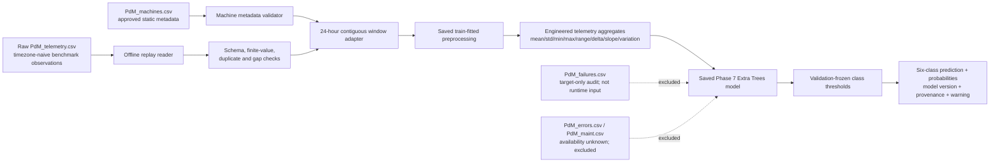

# Azure PdM Phase 8–9 architecture and data flow

MQTT and InfluxDB are future ingestion sources only. No live connection is made by this demonstration, and the adapter remains independent of the existing FD001 contract.
